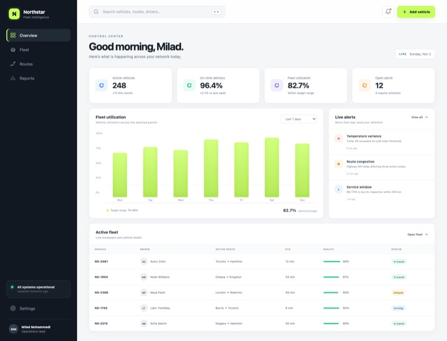
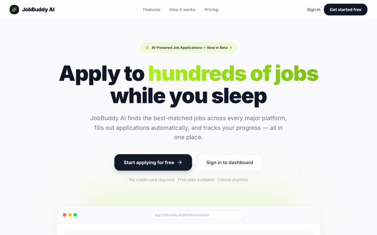
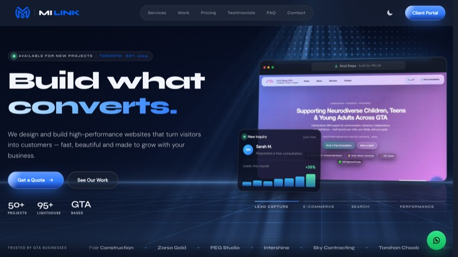
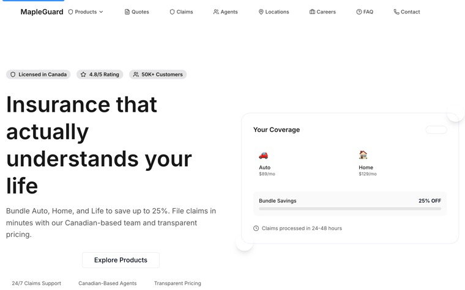
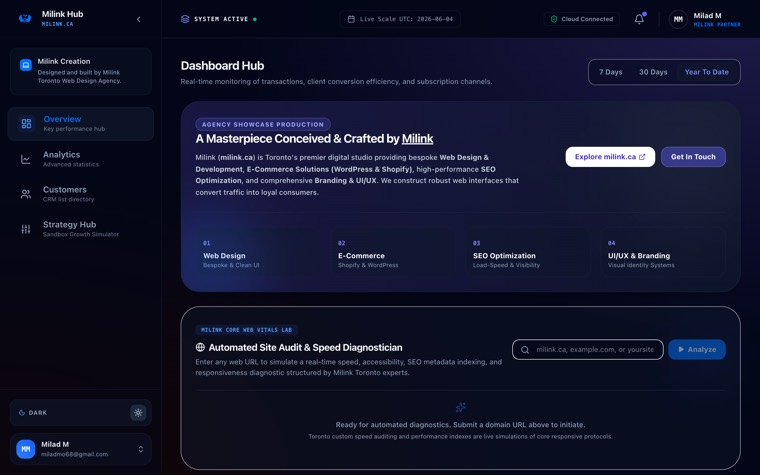
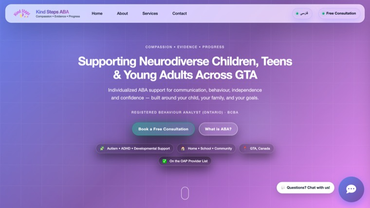

  

  

  
  
  
  

## 👋 About me

I'm **Milad**, a frontend-focused Full-Stack Developer in **Toronto** with **5+ years** of experience building responsive web apps, dashboards and user portals with **React, Next.js and TypeScript** — backed by **Node.js, Express, MongoDB and PostgreSQL**.

- ⚡ I care about **performance, accessibility and clean, reusable components**
- 🏗️ Most recently I built **investor-facing portals** for an enterprise asset-management platform
- 🌐 Through my studio **[MiLink](https://milink.ca)** I design and ship websites for local businesses
- 🚀 Every project below is **live** — click through and try it

## 🌟 Featured work

<table>
  <tr>
    <td width="50%" valign="top">
      
      <h3>🚚 Northstar Ops</h3>
      
Fleet-intelligence dashboard: KPIs, utilization chart, live alerts and an active-fleet table.

      
<code>Next.js</code> <code>TypeScript</code> <code>React</code>

      <a href="https://miladmo68.github.io/northstar-ops-dashboard/">Live</a> · <a href="https://github.com/miladmo68/northstar-ops-dashboard">Code</a>
    </td>
    <td width="50%" valign="top">
      
      <h3>🤖 JobBuddy AI</h3>
      
SaaS that matches people with jobs and helps them apply with AI, with subscriptions and tracking.

      
<code>Next.js</code> <code>Supabase</code> <code>Stripe</code> <code>Gemini</code>

      <a href="https://job-apply-ai-three.vercel.app/">Live</a> · <a href="https://github.com/miladmo68/Job-Apply-AI">Code</a>
    </td>
  </tr>
  <tr>
    <td width="50%" valign="top">
      
      <h3>🚀 MiLink</h3>
      
Production platform for my web studio: marketing site, pricing and a client portal with billing.

      
<code>Next.js</code> <code>Tailwind</code> <code>Supabase</code> <code>Stripe</code>

      <a href="https://milink.ca/">Live</a> · <a href="https://github.com/miladmo68/milink-pro">Code</a>
    </td>
    <td width="50%" valign="top">
      
      <h3>🍁 MapleGuard Insurance</h3>
      
Accessible insurance website with product pages and a multi-step, validated quote flow.

      
<code>Next.js</code> <code>TypeScript</code> <code>Zod</code>

      <a href="https://miladmo68.github.io/MapleGuard-Insurance/">Live</a> · <a href="https://github.com/miladmo68/MapleGuard-Insurance">Code</a>
    </td>
  </tr>
  <tr>
    <td width="50%" valign="top">
      
      <h3>📊 MiLink Analytics</h3>
      
Business analytics dashboard with interactive charts and an AI operations analyzer.

      
<code>React</code> <code>TypeScript</code> <code>Gemini</code>

      <a href="https://analytics-dashboard-seven-snowy.vercel.app/">Live</a> · <a href="https://github.com/miladmo68/Analytics-Dashboard">Code</a>
    </td>
    <td width="50%" valign="top">
      
      <h3>🧩 Kind Steps ABA</h3>
      
Calm, bilingual (English &amp; Persian) website for an ABA therapy provider in the GTA.

      
<code>HTML</code> <code>CSS</code> <code>JavaScript</code> <code>Node.js</code>

      <a href="https://kindsteps.ca/">Live</a> · <a href="https://github.com/miladmo68/Kind-Steps-">Code</a>
    </td>
  </tr>
</table>

<a href="https://miladweb.com"><b>See all projects on miladweb.com →</b></a>

## 🛠️ Tech stack

| | |
| --- | --- |
| **Frontend** |  |
| **UI & State** |  |
| **Backend & Data** |  |
| **Testing & Delivery** |  |

## 🤝 Client websites

Built and shipped for businesses across the GTA:
[Fair Construction](https://fairconstruction-ca.vercel.app/) ·
[Zarsa Gold](https://zarsa2.vercel.app/) ·
[Kind Steps](https://kindsteps.ca/) ·
[Intershine](https://intershine-ca.vercel.app/) ·
[PEG Studio](https://peg-studio-ten.vercel.app/) ·
[Sky Contracting](https://skyinc.ca/) ·
[Tarahan Choob](https://woodline-ir.vercel.app/) ·
[Techfahm Systems](https://techfahm.com/)

## 📈 GitHub activity

  

---

  <b>Have a project or a role in mind?</b> 
  <a href="mailto:info@miladweb.com">info@miladweb.com</a> · <a href="https://miladweb.com">miladweb.com</a> · <a href="https://www.linkedin.com/in/miladmo68/">LinkedIn</a>

